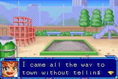
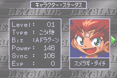

# Beyblade: Gekitou! Saikyou Blader — English translation

An experimental English fan translation of **Bakuten Shoot Beyblade — Gekitou! Saikyou Blader**, the Japanese Game Boy Advance game with cartridge code **AHEJ**.

[Leia em português](README.pt-BR.md).

This experimental project is shared as an IPS patch and editable sources. It was developed with GPT assistance. The original ROM, emulator, and save files are not included.

## Current progress

- **587 translated speeches across 308 scenes.**
- **816 translated interface strings.**
- **62 structured location, shop, and navigation strings across 28 resources.**
- **837 translated battle resources across 1,259 pages.**
- Built-in narrow Latin font, with up to 24 characters per line and extra dialogue pages.
- Original Japanese character names and speaker order preserved.

These numbers describe completed source entries, not a completion percentage. The preliminary extraction contains 1,251 candidate speeches, including test text and potentially repeated records. It is not a complete verified script.

The translation is incomplete. Some graphic menus and part names remain Japanese, as do scenes with unsupported commands and other unworked text. Visual review is partial; the full game has not been tested. See [progress and test coverage](docs/PROGRESS.md).




## Apply the patch

You need Python 3.10 or newer and your own matching original ROM. The patcher uses only Python's standard library and creates a new file.

Supported original SHA-256:

```text
58b7ad86fae87e572e8474eb935ecda165e71c741096cd687f96bed96fbba05c
```

```sh
python tools/apply_patch.py --rom "/path/to/original.gba" --patch patches/Beyblade-AHEJ-English-v150-EXPERIMENTAL.ips --output "/path/to/Beyblade-English-v150.gba"
```

The original file must be unmodified. The patcher rejects other hashes and refuses to overwrite existing output files. Open the resulting `.gba` with a GBA emulator. Tests so far used the mGBA libretro core; compatibility with other emulators and hardware is not established.

## Build from editable translations

```sh
python tools/build.py --rom "/path/to/original.gba"
```

Outputs are written under the ignored `build/` directory. The build checks the original hash, validates speaker order and supported commands, relocates translated resources, applies the font changes, builds the IPS, and independently reapplies the patch to compare the result byte-for-byte.

Edit `translations/dialogue-en.json` for dialogue and `translations/menus-en.json` for UI labels. Read the [contribution guide](CONTRIBUTING.md) and [technical notes](docs/FORMAT.md) first.

## Project files

- `translations/`: editable English script and UI text.
- `tools/`: standard-library extraction, build, patching, and verification scripts.
- `tables/beyblade-ahej.tbl`: CP932 character mapping and observed command markers for compatible hex editors.
- `docs/`: progress, reverse-engineering notes, screenshots, and release instructions.
- `patches/`: IPS patch and release metadata; no ROM.

The `.tbl` is an inspection aid, not a complete script parser. Parameter bytes and resource pointers need the project scripts.

## Credits and project status

This work uses original analysis and purpose-built scripts. [Meowth GBA Translator](https://github.com/Olcmyk/Meowth-GBA-Translator) provided a workflow reference, and [mGBA](https://github.com/mgba-emu/mgba) was used for testing. The [V-Force decompilation](https://github.com/marijnvdwerf/gba-beyblade-vforce) and [GBA matching-decomp skill](https://github.com/FacundoMainere/gba-matching-decomp-skill) were reviewed as references; their code is not bundled here.

This is an unofficial project, with no affiliation to the game's rights holders. No original ROM, emulator binary, or save state is included. Project-wide licensing has not yet been selected; record it before a public contribution release.
