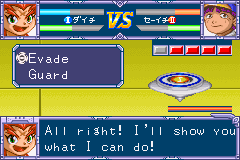

# Reaction timer position, version 0.19

The five-cell timer shown during an incoming attack now appears at the upper right, immediately below the health/energy HUD. It occupies BG1 tile columns 19–28 and rows 5–6 instead of rows 15–16, moving it upward by 80 pixels while retaining its horizontal position.

The pointer literals at ROM offsets `0x19AD4`, `0x19BA0`, and `0x19C08` change from `0x06000BF6` to `0x06000976`. They cover drawing, individual-cell clearing, and whole-bar clearing. The countdown, colors, duration, and input handling do not change.

The clearing routines previously used tile `0x19`, which matches the dialogue background. At the new arena position, two helpers at `0x400080` and `0x400088`, called from `0x19B6C` and `0x19BAE`, supply transparent tile `0xF3FF` instead. This prevents a blue rectangle from remaining over the arena as cells expire.

Six paired frame snapshots reproduced the same timer states before and after the move, with only the intended transparent clearing substitution. Visual inspection covered a partial countdown, removal, and a second attack. Full-game and hardware coverage are not claimed.

