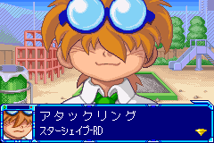

# Highlighted reward-name crash, fixed in version 0.20

The user reported invalid CPU execution after receiving parts following a battle. A native mGBA `.ss1` file captured just before the failure reproduced the issue with version 0.18.

The state is a PNG container. Its `gbAs` chunk contains a zlib-compressed emulator state. The original file was kept unchanged; the extracted private copy was used for the targeted replay and is not included in the distributable project.

## Cause

The original story renderer's `HH` highlighted-text path sets narrow-font mode at `0xFC9A` and branches to `0xFCAC`. The translation's font selector replaced the instructions at `0xFCAA` and `0xFCAC` with a single 32-bit Thumb BL instruction. The original HH branch therefore entered the second half of that BL instead of an instruction boundary, leading to invalid control flow.

This path is used by a runtime-generated reward stream containing the part category, `KK`, `HH`, the item name, and `WWEE`. Earlier isolated tests of static dialogue did not exercise this caller.

## Fix

The four bytes at `0xFC9A` now call a trampoline at `0x400100`. It sets `r2 = 1` and `r3 = 1`, retaining highlighted/narrow text rendering, and resumes at `0xFCAE`, after the complete font-selector instruction. The trampoline adjusts its return address by 16 bytes from `0xFC9F` to `0xFCAF`; the low Thumb bit is retained.

The only changes from version 0.19 are this call site and the 12-byte trampoline. Reward selection, translated resources, and the relocated battle reaction timer are unchanged.

## Targeted validation

One 240-frame replay from the supplied pre-error state advanced through the item name and subsequent translated reward text. Its final CPU address was valid. The portable build and independent IPS application reproduced the development output. This is a regression check for the reported sequence, not full-game coverage.

